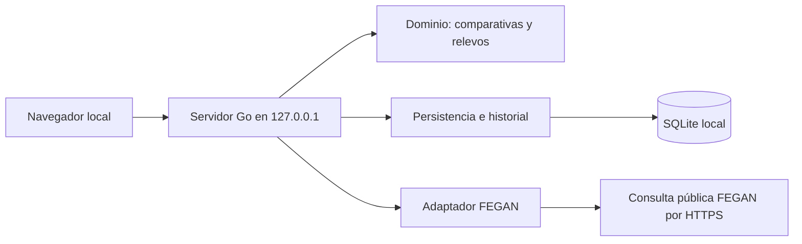

# Arquitectura de FEGAN Master Team

Estado: primera implementación local, 26 de octubre de 2026. La temporada va de octubre a septiembre y la edad se calcula a 31 de diciembre de su segundo año. Las reglas de relevos se basan en las circulares 26-32 y 26-30, con la elegibilidad de categorías inferiores confirmada por el usuario (D06 y D15).

## Objetivo y restricciones

Aplicación de una sola persona en su ordenador, sin cuentas ni sincronización compartida. Se ejecuta en Windows, macOS y Linux, abre el navegador y almacena datos en SQLite. La conexión externa solo es necesaria al consultar FEGAN. No se publican ni sincronizan datos con GitHub.

## Componentes

- `cmd/fegan-master-team`: configuración, apertura del navegador, puerto y cierre ordenado.
- `internal/domain`: validación, tiempos exactos en centésimas, comparativas y optimización de relevos. No depende de HTTP ni de la base de datos.
- `internal/store`: transacciones, identidades, deduplicación, historial y copias de seguridad.
- `internal/fegan`: protocolo de consulta, límites, caché temporal y análisis HTML. Separa cambios en la web externa del dominio. Lee catálogos y resultados PDF con un lector puro Go, y usa Lenex solo para verificar alias y códigos de clubes.
- `internal/syncer`: trabajo automático en segundo plano, progreso, consultas compartidas y persistencia del estado.
- `internal/web`: API JSON y HTML/CSS/JavaScript integrados mediante `embed`. Sin CDN, Node ni compilación de interfaz como requisitos de ejecución.

## Decisiones principales

1. **Go y ejecutable autónomo.** El navegador ya resuelve la interfaz entre sistemas; no se incluye una plataforma de escritorio. La apertura automática es un intento: la dirección se imprime siempre.
2. **SQLite con modernc.org/sqlite.** Controlador Go sin CGO para compilar por sistema y arquitectura. Dependencias fijadas en go.mod/go.sum. Un solo acceso de base de datos a la vez simplifica la consistencia en este producto local.
3. **Modelo relacional con cargas JSON.** Esquema 3: conserva configuración y estado en `settings` y añade exclusiones de registros borrados en `suppressed`. La migración desde 1 o 2 crea una copia `.vN-UUID.bak` antes de migrar y conserva las entidades existentes.  Claves, relaciones e índices en SQL; el contenido de entidades se conserva como JSON validado por Go. Esta primera versión permite evolución con poca duplicación entre API y almacenamiento. El coste es no disponer de consultas analíticas SQL completas por cada atributo. Los cálculos leen una instantánea en memoria; revaluar ante volúmenes grandes.
4. **Identidad explícita.** Club y licencia son cadenas, nunca números. La licencia es la clave primaria del nadador. Un resultado conserva el club con el que se registró; la ficha contiene el club actual gestionado localmente. No se deduce identidad por nombre.
5. **Carga automática y consulta manual.** La selección inicial del club autoriza su carga automática y la de rivales/relevos; se muestra progreso y errores. Las ediciones de nadadores y marcas programan actualización de rivales. Al abrir con club configurado se actualiza si no existe una actualización completa sin incidencias del día; se puede forzar desde la interfaz. Cada consulta se guarda transaccionalmente y las consultas ya correctas no se revierten por un fallo posterior de otra fuente. La consulta manual adicional mantiene dos pasos.  La consulta solo genera una vista previa en memoria con caducidad de 15 minutos. La confirmación guarda una transacción completa. La vista previa original permanece en el servidor: el navegador no puede sustituir sus resultados.
6. **Trazabilidad.** Marca con origen, URL, fecha de consulta, verificación y notas. El historial conserva versiones previas de entidades editadas y resúmenes de importación con filtros. Una corrección mantiene su origen; verificar no significa homologación oficial.
7. **Idempotencia.** Huella del contenido deportivo de la marca, excluyendo ID y metadatos de origen. Las correcciones conservan la huella original para impedir que una reimportación restaure la versión externa. El resultado modificado por FEGAN se puede incorporar como una fila nueva: la conciliación de rectificaciones externas no se automatiza.
8. **Separación deportiva.** Comparaciones por piscina, cronometraje, categoría y ventana de fechas. Se excluyen parciales en origen. No se convierten marcas entre piscinas o cronometrajes. La temporada seleccionada determina las edades; los grupos individuales son 20–24, 25–29, etc., y 100+ abierto. La interfaz de relevos aplica criterios comunes de edad sin seleccionar normativa; muestra grupos separados por piscina y cronometraje. Los perfiles explícitos se conservan en la API para compatibilidad.
9. **Protección local.** Solo `127.0.0.1`, puerto asignado por el sistema o elegido por usuario. Comprobación de Host, Origin y token por instancia para operaciones POST; CSP sin scripts externos, escape de textos, límites de cuerpo y plazos HTTP. No protege frente a otros procesos de la misma cuenta. La base no está cifrada; usa las protecciones del sistema operativo.
10. **Recuperación.** Copia consistente con `VACUUM INTO`, independiente del archivo activo. Restauración con la aplicación detenida, tras conservar la base anterior. Hay borrado definitivo con confirmación y recuento de dependencias. Se eliminan marcas, versiones y dependencias en una transacción, incluidas licencias de relevos. Se mantienen hashes de exclusión para impedir reimportaciones automáticas; una alta manual puede recrear la identidad. Las copias antiguas permanecen bajo control del usuario.

## Contrato externo y carga

FEGAN se consulta por POST a `https://www.fegan.org/marks/`, con estamento MASTE. El adaptador comprueba el catálogo de clubes y las diez columnas de la tabla `dvData`; no trata una página desconocida como importación vacía. Reconoce el mensaje de ausencia de resultados observado el 26/10/2026.

Se solicitan hasta 100 marcas sin «solo la mejor» ni comparación ponderada. Al alcanzar 100 se divide el intervalo en días disjuntos y se repite; si un día llega a 100, se rechaza la operación por posible truncamiento. Límite de 64 peticiones por prueba, 150 segundos por consulta síncrona compatible; 30 minutos por consulta amplia en segundo plano y una consulta de usuario simultánea. Las consultas se espacian al menos un segundo. Caché en memoria de 15 minutos y hasta ocho consultas individuales. Un fallo no guarda parcialmente esa consulta; puede reutilizarse caché válida en el siguiente intento. El trabajo automático dispone de 30 minutos y guarda resultados correctos por consulta, comunicando cualquier consulta fallida.

«Todas las pruebas» recorre las pruebas individuales del catálogo observado. La interfaz consulta ambas piscinas y cronometrajes automáticamente, y M/F cuando la categoría está vacía. Cada consulta real conserva filtros exactos. La preparación se realiza en segundo plano con consulta de estado para no agotar la respuesta HTTP; solo se guarda tras revisión. La consulta manual sigue disponible; la carga inicial automática recorre ambas categorías, piscinas y cronometrajes. Los relevos se importan desde PDF, como se detalla a continuación.

## Club primero, rivales y resultados PDF

El arranque sin club del equipo muestra obligatoriamente su selección. El catálogo se obtiene de `clubs_activos.pdf` bajo la ruta de la temporada actual, verificando la temporada impresa; la URL 2025/26 facilitada por el usuario se utilizó como referencia de formato y se verificó también el documento 2026/27. Se guardan código, nombre largo, medio y corto, fuente y temporada. El informe puede marcar clubes sin licencias actuales: se ofrece el catálogo publicado sin inferir actividad de los colores ni impedir la gestión de un club histórico. Hay alta manual y uso del catálogo guardado si falla la conexión.

Rivales: ventana móvil de dos años desde la fecha de actualización. Las pruebas relevantes son aquellas con marcas del miembro del club dentro de esa ventana. Se agrupan consultas por categoría M/F, grupo de edad de la temporada objetivo, prueba, piscina y cronometraje. FEGAN recibe `input_best_mark=on` y `combo_show_first=10`, sin conversión ponderada. Se toma una marca por licencia, ordenada por tiempo, hasta diez. No se backfillea un puesto si uno de los diez es del propio equipo. Las consultas correctas se registran por grupo y día en SQLite: los cambios posteriores consultan solo combinaciones nuevas, salvo actualización manual forzada. Una respuesta top diez fuera de filtros activa una consulta de historial como alternativa; si también falla, se informa sin guardar ese grupo. La comparativa local limita también las referencias a las diez mejores del grupo y conserva la marca propia para calcular su puesto.

Relevos: se descubre la lista de campeonatos en `/post/57` y sus archivos históricos desde `/post/20`. Se seleccionan las dos temporadas más recientes con resultados publicados, sin confundirlas con los dos años móviles de marcas individuales. El 26/10/2026 eran 2025/26 y 2024/25. Se eliminan enlaces duplicados por fecha de campeonato. Se leen resultados completos del ZIP oficial, PDF directo si funciona, o PDF por prueba de la web oficial enlazada. Los enlaces HTTP del propio dominio se normalizan a HTTPS; no se buscan versiones de URL adivinadas ni se cambia de proveedor.

Los PDF se analizan en Go, sin herramientas instaladas en ejecución. Se reconocen encabezados de prueba, categoría, piscina, fecha y filas clasificadas. Se excluyen bajas y descalificaciones y no se interpretan los parciales individuales como marcas de relevos. El código de club se vincula por catálogo o por alias acreditado en el Lenex oficial del mismo campeonato; un alias desconocido se comunica y su fila no se incorpora. Se conserva categoría inscrita y URL del PDF (o ZIP y entrada) con procedencia `fegan-pdf`. El nombre canónico del campeonato evita duplicados cuando un resultado pasa de la página actual al archivo.

Límites: descargas de 32 MiB, PDF de 20 MiB/400 páginas, ZIP con hasta 600 entradas y 80 MiB descomprimidos, sin extracción a disco. El lector PDF está fijado a una versión compatible con Go 1.26. Los PDF escaneados sin texto o formatos desconocidos producen error explícito. El progreso distingue carga en curso y finalizada con avisos; resultados parciales por fuentes fallidas nunca se presentan como cobertura completa.

## Algoritmos y límites

- Individuales: mejor marca por licencia y prueba, con hasta diez referencias observadas; mismo grupo según la edad a 31/12 del segundo año de la temporada seleccionada. Puesto = 1 + número de rivales con mejor tiempo. Empates comparten puesto. Ordena pruebas con rivales antes que pruebas sin comparación, después por puesto, diferencia al primero y código de prueba. No estima probabilidades.
- Relevos: cuatro licencias distintas del mismo club actual, miembros y disponibles. Mixtos: dos M y dos F. Libre solo utiliza libre; estilos asigna E, B, M y L. Explora candidatos y poda con una cota inferior de tiempo; hasta 20 propuestas por categoría. Dos millones de nodos por categoría producen error explícito, nunca una lista parcial presentada como óptima.
- Categorías +80, +100, +120, +160, +200, +240, +280 y +320. La banda natural por suma es informativa: según la aclaración del usuario, los no premáster pueden escoger categorías inferiores cuya edad mínima alcancen, sin máximo de suma impuesto por la banda. Los de 20–24 años solo participan en +80, también cuando la suma real del equipo supera 99. Se excluyen menores de 20.
- Se comparan todas las categorías elegibles o una seleccionada. Cada marca de relevo rival almacena la categoría inscrita por separado de la suma real opcional. Una marca antigua sin categoría explícita queda fuera de estas comparativas hasta que se revise, sin asignarla automáticamente por suma.
- Recomendación de categoría: exige al menos tres clubes rivales observados. Ordena por mejor puesto y después por margen relativo respecto al tercer rival. Si faltan referencias, muestra composiciones pero no inventa una categoría competitivamente recomendada. El margen es una diferencia de tiempo, no probabilidad de medalla.
- Estimación por suma sin corrección de salidas. La comparación conserva la mejor marca por club rival y categoría, acorde con un equipo por club/categoría en las circulares. No modela todos los inscritos ni garantiza exhaustividad.
- Perfiles: invierno 26-32 y liga 26-30. Ambos contemplan 4x50 libre/estilos. Invierno utiliza referencias verificadas desde 01/09/2023 y avisa de revisar su acreditación. Liga permite aproximadas si no se filtra solo verificadas y avisa del máximo de un relevo por nadador/jornada. Para otra temporada se muestra advertencia de simulación con normativa 2026/27.
- No decide inscripciones simultáneas, descansos, límites de pruebas por nadador, múltiples equipos sin integrantes compartidos ni puntuación de un campeonato. Cada propuesta es independiente.

## Referencia Java

Se ha leído la copia local `/Users/marianoao/Projects/personal/marianoao/fegan-relay-calculator`, especialmente `service/Marks.java`, `service/Relays.java` y `domain/Relay.java`, `SwimmerBestMarks.java`, `EventMark.java`.

Se conserva la idea de comparar oportunidades por prueba y explorar composiciones. Se reemplazan: tiempos float por centésimas; puntuación heurística por posición/diferencia observada; búsqueda de género por categoría solicitada explícitamente; selección del mejor estilo para libre por selección exclusiva de libre; clasificación única derivada de suma por comparación de categorías elegibles y temporada explícita. Véase docs/java-reference.md y docs/regulations.md.

## Edición, borrado y carga local de PDF (D26–D31)

Clubes y Nadadores disponen de pantallas separadas. Los nombres de la base local prevalecen sobre el catálogo al mostrar y seleccionar clubes; código y nombre medio (o largo si falta) aparecen juntos. La ordenación se realiza con `Intl.Collator` español sobre ese nombre. La ficha de marca individual resuelve nombre o licencia a una única licencia conocida, calcula categoría con la fecha del resultado y propone el club actual solo al cambiar de nadador. La edición conserva el club histórico.

`Store.Delete` usa el mismo bloqueo y transacción que las importaciones. Elimina las marcas individuales del nadador en cualquier club y los relevos que lo incluyan expresamente. Borrar un club elimina sus nadadores actuales y sus dependencias, más resultados históricos de ese club; no elimina otros nadadores por haber competido antes en él. Se eliminan las versiones de entidades afectadas y los resúmenes de importación, que pueden contener licencias en sus filtros. No se conserva una copia de lo borrado en el historial. `suppressed(kind,key)` guarda SHA-256 de identidad o huella deportiva, incluida la huella original de marcas corregidas. Las importaciones posteriores o concurrentes respetan esas exclusiones. Los hashes de identificadores no equivalen a anonimización criptográfica; su finalidad es evitar resurrecciones. El club propio borrado deja la selección inicial vacía. El catálogo de referencia puede seguir ofreciéndolo para un alta explícita posterior.

Los PDF locales usan multipart limitado a 21 MiB, un archivo de hasta 20 MiB y el mismo analizador Go (400 páginas). No se envía el archivo a FEGAN ni se necesitan programas externos. Se elige invierno/verano, fecha de respaldo y cronometraje declarado, con verificación local desactivada inicialmente. Los encabezados de fecha reconocidos prevalecen sobre la fecha de respaldo. Fuente `local-pdf`, referencia `local-pdf:SHA256/nombre`, sin guardar ruta local ni archivo PDF. Nombres desconocidos se avisan y pueden vincularse explícitamente a códigos del catálogo guardado/base local. La vista previa permanece en el servidor 15 minutos y se confirma por el mismo mecanismo transaccional de importación. Se deduplica con la fuente web cuando coincide el contenido deportivo y el nombre canónico del campeonato. Un cambio de club actual no reescribe el club histórico.

Elegir pruebas determina la temporada actual en el servidor y devuelve detalles de rivales (identidad, mejor marca, fecha y club histórico). El cronometraje se expande en grupos E/M, conservando la piscina elegida. Componer relevos expande 25/50 m y E/M y calcula por separado; sin perfil no fuerza referencias verificadas desde 2023 ni restricciones de una competición concreta. La recomendación de categoría se decide dentro de cada grupo comparable. No se comparan entre sí piscinas o cronometrajes ni se convierten tiempos.

## Ciclo de vida del navegador (D32)

En el arranque normal una conexión HTTP persistente por pestaña enlaza su vida con la aplicación. Solo al desaparecer la última conexión se programa la salida, con cinco segundos para recargar/reconectar. No se usan latidos periódicos de JavaScript sujetos a la limitación de pestañas de fondo ni se supone que el proceso del lanzador (`open`, `xdg-open`, `rundll32`) represente la vida del navegador. La respuesta de presencia requiere el token y los controles de origen habituales, y es la única sin plazo de escritura de 180 segundos. No hay salida automática antes de la primera conexión. `-no-browser` conserva el uso como servidor independiente. Se cierra HTTP, se cancelan/esperan trabajos y se cierra SQLite; no se mata el proceso con os.Exit.

Recarga, múltiples pestañas y cierre de conexión están cubiertos por pruebas. Cerrar la pestaña, navegar fuera o perder completamente su conexión durante más del margen tienen el mismo efecto. La aplicación no inspecciona ventanas de otros programas ni garantiza distinguir una pestaña descartada por el navegador de una cerrada.

## Reinicio completo (D33)

Ajustes ofrece un borrado global explícito, con diálogo de alcance y recuentos al abrirlo. Exige escribir REINICIAR para habilitar el botón final; la API exige la misma confirmación y token local válido. Cancelar o enviar confirmación inválida no detiene trabajos ni altera datos. No se hace una copia oculta: se ofrece descargar una antes de reiniciar y se conservan las copias existentes.

El reinicio cancela el contexto de la generación de datos actual y suspende el sincronizador para impedir nuevos productores. La cancelación precede a esperar bloqueos, porque las peticiones HTTP y los trabajos pueden compartir el cliente FEGAN. Una barrera exclusiva espera que terminen las demás peticiones API y los trabajos asíncronos. La conexión de presencia del navegador queda fuera de esa barrera y sigue viva durante el reinicio. `Store.Reset` vacía marks, swimmers, clubs, history, settings y suppressed en una transacción; un error revierte el conjunto. Conserva schema_version y el esquema actual, sin necesidad de migración.

Se descartan vistas previas, consultas y cachés, se crea un sincronizador vacío y se renueva el contexto de trabajo. Un token nuevo impide escrituras pendientes de pestañas antiguas: deben recargarse. Las peticiones que esperaban el bloqueo con el contexto antiguo tampoco pueden ejecutarse sobre la base nueva. Se recarga la interfaz en el primer paso; el catálogo vuelve a consultarse como en un primer arranque. El proceso permanece abierto y SQLite sigue en la misma ruta. No se purgan las copias existentes ni se garantiza borrado forense de páginas libres del archivo.
