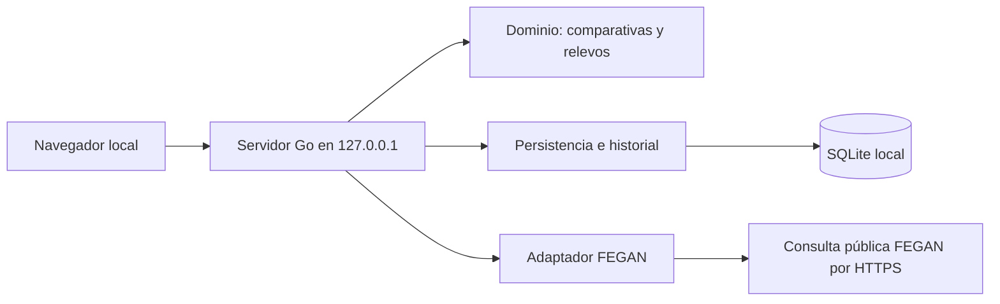

# Arquitectura de FEGAN Master Team

Estado: implementación local, revisada el 28 de octubre de 2026. La temporada va de octubre a septiembre y la edad se calcula a 31 de diciembre de su segundo año. Las reglas de relevos se basan en las circulares 26-32 y 26-30, con la elegibilidad de categorías inferiores confirmada por el usuario (D06 y D15).

## Objetivo y restricciones

Aplicación de una sola persona en su ordenador, sin cuentas ni sincronización compartida. Se ejecuta en Windows, macOS y Linux, abre el navegador y almacena datos en SQLite. La conexión externa solo es necesaria al consultar FEGAN. No se publican ni sincronizan datos con GitHub.

## Componentes

- `cmd/fegan-master-team`: configuración, apertura del navegador, puerto y cierre ordenado.
- `internal/domain`: validación, tiempos exactos en centésimas, comparativas y optimización de relevos. No depende de HTTP ni de la base de datos.
- `internal/store`: transacciones, identidades, deduplicación, historial y copias de seguridad.
- `internal/fegan`: protocolo de consulta, límites, caché temporal y análisis HTML. Separa cambios en la web externa del dominio. Lee catálogos y resultados PDF con un lector puro Go, y usa Lenex solo para verificar alias y códigos de clubes.
- `internal/syncer`: trabajo automático en segundo plano, progreso, consultas compartidas y persistencia del estado.
- `internal/web`: API JSON y HTML/CSS/JavaScript integrados mediante `embed`. Sin CDN, Node ni compilación de interfaz como requisitos de ejecución.

## Decisiones principales

1. **Go y ejecutable autónomo.** El navegador ya resuelve la interfaz entre sistemas; no se incluye una plataforma de escritorio. La apertura automática es un intento: la dirección se imprime siempre.
2. **SQLite con modernc.org/sqlite.** Controlador Go sin CGO para compilar por sistema y arquitectura. Dependencias fijadas en go.mod/go.sum. Un solo acceso de base de datos a la vez simplifica la consistencia en este producto local.
3. **Modelo relacional con cargas JSON.** Esquema 3: conserva configuración y estado en `settings` y añade exclusiones de registros borrados en `suppressed`. La migración desde 1 o 2 crea una copia `.vN-UUID.bak` antes de migrar y conserva las entidades existentes.  Claves, relaciones e índices en SQL; el contenido de entidades se conserva como JSON validado por Go. Esta primera versión permite evolución con poca duplicación entre API y almacenamiento. El coste es no disponer de consultas analíticas SQL completas por cada atributo. Los cálculos leen una instantánea en memoria; revaluar ante volúmenes grandes.
4. **Identidad explícita.** Club y licencia son cadenas, nunca números. La licencia es la clave primaria del nadador. Un resultado conserva el club con el que se registró; la ficha contiene el club actual gestionado localmente. No se deduce identidad por nombre.
5. **Carga automática y consulta manual.** La selección inicial del club autoriza su carga automática y la de rivales/relevos; se muestra progreso y errores. Las ediciones de nadadores y marcas programan actualización de rivales. Al abrir con club configurado se actualiza si no existe una actualización completa sin incidencias del día; se puede forzar desde la interfaz. Cada consulta se guarda transaccionalmente y las consultas ya correctas no se revierten por un fallo posterior de otra fuente. La consulta manual adicional mantiene dos pasos.  La consulta solo genera una vista previa en memoria con caducidad de 15 minutos. La confirmación guarda una transacción completa. La vista previa original permanece en el servidor: el navegador no puede sustituir sus resultados.
6. **Trazabilidad.** Marca con origen, URL, fecha de consulta, verificación y notas. El historial conserva versiones previas de entidades editadas y resúmenes de importación con filtros. Una corrección mantiene su origen; verificar no significa homologación oficial.
7. **Idempotencia.** Huella del contenido deportivo de la marca, excluyendo ID y metadatos de origen. Las correcciones conservan la huella original para impedir que una reimportación restaure la versión externa. El resultado modificado por FEGAN se puede incorporar como una fila nueva: la conciliación de rectificaciones externas no se automatiza.
8. **Separación deportiva.** Comparaciones por piscina, categoría y ventana de fechas; referencias convertidas a electrónico en oportunidades por D49 y E/M combinados sin ajuste en relevos por D41. Se excluyen parciales en origen. D49 aplica la tabla aditiva FMN aportada a piscina y cronometraje solo en oportunidades, sin modificar marcas guardadas. La temporada seleccionada determina las edades; los grupos individuales son 20–24, 25–29, etc., y 100+ abierto. La interfaz de relevos aplica criterios comunes de edad sin seleccionar normativa; muestra piscinas separadas y combina E/M sin conversión. La API distingue tipos de competición championship/league, sin identificadores ligados a temporadas.
9. **Protección local.** Solo `127.0.0.1`, puerto asignado por el sistema o elegido por usuario. Comprobación de Host, Origin y token por instancia para operaciones POST; CSP sin scripts externos, escape de textos, límites de cuerpo y plazos HTTP. No protege frente a otros procesos de la misma cuenta. La base no está cifrada; usa las protecciones del sistema operativo.
10. **Recuperación.** Copia consistente con `VACUUM INTO`, independiente del archivo activo. Restauración con la aplicación detenida, tras conservar la base anterior. Hay borrado definitivo con confirmación y recuento de dependencias. Se eliminan marcas, versiones y dependencias en una transacción, incluidas licencias de relevos. Se mantienen hashes de exclusión para impedir reimportaciones automáticas; una alta manual puede recrear la identidad. Las copias antiguas permanecen bajo control del usuario.

## Contrato externo y carga

FEGAN se consulta por POST a `https://www.fegan.org/marks/`, con estamento MASTE. El adaptador comprueba el catálogo de clubes y las diez columnas de la tabla `dvData`; no trata una página desconocida como importación vacía. Reconoce el mensaje de ausencia de resultados observado el 26/10/2026.

Se solicitan hasta 100 marcas sin «solo la mejor» ni comparación ponderada. Al alcanzar 100 se divide el intervalo en días disjuntos y se repite; si un día llega a 100, se rechaza la operación por posible truncamiento. Límite de 64 peticiones por prueba, 150 segundos por consulta síncrona compatible; 30 minutos por consulta amplia en segundo plano y una consulta de usuario simultánea. Las consultas se espacian al menos un segundo. Caché en memoria de 15 minutos y hasta ocho consultas individuales. Un fallo no guarda parcialmente esa consulta; puede reutilizarse caché válida en el siguiente intento. El trabajo automático dispone de 30 minutos y guarda resultados correctos por consulta, comunicando cualquier consulta fallida.

«Todas las pruebas» recorre las pruebas individuales del catálogo observado. La interfaz consulta ambas piscinas y cronometrajes automáticamente, y M/F cuando la categoría está vacía. Cada consulta real conserva filtros exactos. La preparación se realiza en segundo plano con consulta de estado para no agotar la respuesta HTTP; solo se guarda tras revisión. La consulta manual sigue disponible; la carga inicial automática recorre ambas categorías, piscinas y cronometrajes. Los relevos se importan desde PDF, como se detalla a continuación.

## Club primero, rivales y resultados PDF

El arranque sin club del equipo muestra obligatoriamente su selección. El catálogo se obtiene de `clubs_activos.pdf` bajo la ruta de la temporada actual, verificando la temporada impresa; la URL 2025/26 facilitada por el usuario se utilizó como referencia de formato y se verificó también el documento 2026/27. Se guardan código, nombre largo, medio y corto, fuente y temporada. El informe puede marcar clubes sin licencias actuales: se ofrece el catálogo publicado sin inferir actividad de los colores ni impedir la gestión de un club histórico. Hay alta manual y uso del catálogo guardado si falla la conexión.

Rivales: ventana móvil de dos años desde la fecha de actualización. Las pruebas relevantes son aquellas con marcas históricas guardadas del miembro del club, sin fecha futura; la ventana de dos años se aplica a los rivales, no al historial propio. Se agrupan consultas por categoría M/F, grupo de edad de la temporada objetivo, prueba, piscina y cronometraje. FEGAN recibe `input_best_mark=on` y `combo_show_first=10`, sin conversión ponderada. Se toma una marca por licencia, ordenada por tiempo, hasta diez. No se backfillea un puesto si uno de los diez es del propio equipo. Las consultas correctas se registran por grupo y día en SQLite: los cambios posteriores consultan solo combinaciones nuevas, salvo actualización manual forzada. Una respuesta top diez fuera de filtros activa una consulta de historial como alternativa; si también falla, se informa sin guardar ese grupo. La comparativa local excluye la licencia propia y limita las referencias disponibles a diez rivales distintos del grupo; la marca propia procede de su historial guardado completo.

Relevos: se descubre la lista de campeonatos en `/post/57` y sus archivos históricos desde `/post/20`. Se seleccionan las dos temporadas más recientes con resultados publicados, sin confundirlas con los dos años móviles de marcas individuales. El 26/10/2026 eran 2025/26 y 2024/25. Se eliminan enlaces duplicados por fecha de campeonato. Se leen resultados completos del ZIP oficial, PDF directo si funciona, o PDF por prueba de la web oficial enlazada. Los enlaces HTTP del propio dominio se normalizan a HTTPS; no se buscan versiones de URL adivinadas ni se cambia de proveedor.

Los PDF se analizan en Go, sin herramientas instaladas en ejecución. Se reconocen encabezados de prueba, categoría, piscina, fecha y filas clasificadas. Se excluyen bajas y descalificaciones y no se interpretan los parciales individuales como marcas de relevos. El código de club se vincula por catálogo o por alias acreditado en el Lenex oficial del mismo campeonato; un alias desconocido se comunica y su fila no se incorpora. Se conserva categoría inscrita y URL del PDF (o ZIP y entrada) con procedencia `fegan-pdf`. El nombre canónico del campeonato evita duplicados cuando un resultado pasa de la página actual al archivo.

Límites: descargas de 32 MiB, PDF de 20 MiB/400 páginas, ZIP con hasta 600 entradas y 80 MiB descomprimidos, sin extracción a disco. El lector PDF está fijado a una versión compatible con Go 1.26. Los PDF escaneados sin texto o formatos desconocidos producen error explícito. El progreso distingue carga en curso y finalizada con avisos; resultados parciales por fuentes fallidas nunca se presentan como cobertura completa.

## Algoritmos y límites

- Individuales: mejor marca histórica propia por prueba en la piscina seleccionada, con cronometraje determinado por ella y hasta diez rivales distintos de los últimos dos años; mismo grupo según la edad a 31/12 del segundo año de la temporada seleccionada. Puesto = 1 + número de rivales con mejor tiempo. Empates comparten puesto. Ordena pruebas con rivales antes que pruebas sin comparación, después por puesto, diferencia al primero y código de prueba. No estima probabilidades.
- Relevos: cuatro licencias distintas del mismo club actual, miembros y disponibles. Mixtos: dos M y dos F. Libre solo utiliza libre; estilos asigna E, B, M y L. Explora candidatos y poda con una cota inferior de tiempo; hasta 20 propuestas por categoría. Dos millones de nodos por categoría producen error explícito, nunca una lista parcial presentada como óptima.
- Categorías +80, +100, +120, +160, +200, +240, +280 y +320. D50 limita las propuestas de cada cuarteto no premáster a la banda natural por suma y la inmediatamente inferior; la libertad de inscripción histórica confirmada en D15 se conserva como contexto, no como alcance del cálculo actual. Los de 20–24 años solo participan en +80, también cuando la suma real del equipo supera 99. Se excluyen menores de 20.
- Se comparan las categorías con algún cuarteto que cumpla D50, o una seleccionada si cumple; no se optimizan categorías inviables por edades. Cada marca de relevo rival almacena la categoría inscrita por separado de la suma real opcional. Una marca antigua sin categoría explícita queda fuera de estas comparativas hasta que se revise, sin asignarla automáticamente por suma.
- Recomendación de categoría: exige al menos tres clubes rivales observados. Ordena por mejor puesto y después por margen relativo respecto al tercer rival. Si faltan referencias, muestra composiciones pero no inventa una categoría competitivamente recomendada. El margen es una diferencia de tiempo, no probabilidad de medalla.
- Estimación por suma sin corrección de salidas. La comparación conserva la mejor marca por club rival y categoría, acorde con un equipo por club/categoría en las circulares. No modela todos los inscritos ni garantiza exhaustividad.
- Tipos de reglas: ChampionshipRules y LeagueRules, independientes de temporada y URL. Campeonato exige referencias verificadas desde la fecha histórica 01/09/2023; liga conserva el filtro voluntario de verificadas y avisa de la participación por jornada. No se desplaza el corte con la temporada ni se atribuye homologación federativa a la verificación local.
- No decide inscripciones simultáneas, descansos, límites de pruebas por nadador, múltiples equipos sin integrantes compartidos ni puntuación de un campeonato. Cada propuesta es independiente.

## Referencia Java

Se ha leído la copia local `/Users/marianoao/Projects/personal/marianoao/fegan-relay-calculator`, especialmente `service/Marks.java`, `service/Relays.java` y `domain/Relay.java`, `SwimmerBestMarks.java`, `EventMark.java`.

Se conserva la idea de comparar oportunidades por prueba y explorar composiciones. Se reemplazan: tiempos float por centésimas; puntuación heurística por posición/diferencia observada; búsqueda de género por categoría solicitada explícitamente; selección del mejor estilo para libre por selección exclusiva de libre; clasificación única derivada de suma por comparación de categorías elegibles y temporada explícita. Véase docs/java-reference.md y docs/regulations.md.

## Edición, borrado y carga local de PDF (D26–D31)

Clubes y Nadadores disponen de pantallas separadas. Los nombres de la base local prevalecen sobre el catálogo al mostrar y seleccionar clubes; código y nombre medio (o largo si falta) aparecen juntos. La ordenación se realiza con `Intl.Collator` español sobre ese nombre. La ficha de marca individual resuelve nombre o licencia a una única licencia conocida, calcula categoría con la fecha del resultado y propone el club actual solo al cambiar de nadador. La edición conserva el club histórico.

`Store.Delete` usa el mismo bloqueo y transacción que las importaciones. Elimina las marcas individuales del nadador en cualquier club y los relevos que lo incluyan expresamente. Borrar un club elimina sus nadadores actuales y sus dependencias, más resultados históricos de ese club; no elimina otros nadadores por haber competido antes en él. Se eliminan las versiones de entidades afectadas y los resúmenes de importación, que pueden contener licencias en sus filtros. No se conserva una copia de lo borrado en el historial. `suppressed(kind,key)` guarda SHA-256 de identidad o huella deportiva, incluida la huella original de marcas corregidas. Las importaciones posteriores o concurrentes respetan esas exclusiones. Los hashes de identificadores no equivalen a anonimización criptográfica; su finalidad es evitar resurrecciones. El club propio borrado deja la selección inicial vacía. El catálogo de referencia puede seguir ofreciéndolo para un alta explícita posterior.

Los PDF locales usan multipart limitado a 21 MiB, un archivo de hasta 20 MiB y el mismo analizador Go (400 páginas). No se envía el archivo a FEGAN ni se necesitan programas externos. Se elige invierno/verano, fecha de respaldo y cronometraje declarado, con verificación local desactivada inicialmente. Los encabezados de fecha reconocidos prevalecen sobre la fecha de respaldo. Fuente `local-pdf`, referencia `local-pdf:SHA256/nombre`, sin guardar ruta local ni archivo PDF. Nombres desconocidos se avisan y pueden vincularse explícitamente a códigos del catálogo guardado/base local. La vista previa permanece en el servidor 15 minutos y se confirma por el mismo mecanismo transaccional de importación. Se deduplica con la fuente web cuando coincide el contenido deportivo y el nombre canónico del campeonato. Un cambio de club actual no reescribe el club histórico.

Elegir pruebas determina la temporada actual en el servidor y devuelve detalles de rivales (identidad, mejor marca, fecha y club histórico). Cada prueba usa referencias normalizadas a 50E con la tabla aportada por D49; los rivales se limitan a dos años móviles. Componer relevos expande 25/50 m y combina E/M en cada piscina; sin perfil no fuerza referencias verificadas desde 2023 ni restricciones de una competición concreta. La recomendación de categoría se decide dentro de cada grupo comparable. La conversión de piscina y crono solo afecta a oportunidades; los relevos combinan cronometrías por petición expresa del usuario.

## Ciclo de vida del navegador (D32)

En el arranque normal una conexión HTTP persistente por pestaña enlaza su vida con la aplicación. Solo al desaparecer la última conexión se programa la salida, con cinco segundos para recargar/reconectar. No se usan latidos periódicos de JavaScript sujetos a la limitación de pestañas de fondo ni se supone que el proceso del lanzador (`open`, `xdg-open`, `rundll32`) represente la vida del navegador. La respuesta de presencia requiere el token y los controles de origen habituales, y es la única sin plazo de escritura de 180 segundos. No hay salida automática antes de la primera conexión. `-no-browser` conserva el uso como servidor independiente. Se cierra HTTP, se cancelan/esperan trabajos y se cierra SQLite; no se mata el proceso con os.Exit.

Recarga, múltiples pestañas y cierre de conexión están cubiertos por pruebas. Cerrar la pestaña, navegar fuera o perder completamente su conexión durante más del margen tienen el mismo efecto. La aplicación no inspecciona ventanas de otros programas ni garantiza distinguir una pestaña descartada por el navegador de una cerrada.

## Reinicio completo (D33)

Ajustes ofrece un borrado global explícito, con diálogo de alcance y recuentos al abrirlo. Exige escribir REINICIAR para habilitar el botón final; la API exige la misma confirmación y token local válido. Cancelar o enviar confirmación inválida no detiene trabajos ni altera datos. No se hace una copia oculta: se ofrece descargar una antes de reiniciar y se conservan las copias existentes.

El reinicio cancela el contexto de la generación de datos actual y suspende el sincronizador para impedir nuevos productores. La cancelación precede a esperar bloqueos, porque las peticiones HTTP y los trabajos pueden compartir el cliente FEGAN. Una barrera exclusiva espera que terminen las demás peticiones API y los trabajos asíncronos. La conexión de presencia del navegador queda fuera de esa barrera y sigue viva durante el reinicio. `Store.Reset` vacía marks, swimmers, clubs, history, settings y suppressed en una transacción; un error revierte el conjunto. Conserva schema_version y el esquema actual, sin necesidad de migración.

Se descartan vistas previas, consultas y cachés, se crea un sincronizador vacío y se renueva el contexto de trabajo. Un token nuevo impide escrituras pendientes de pestañas antiguas: deben recargarse. Las peticiones que esperaban el bloqueo con el contexto antiguo tampoco pueden ejecutarse sobre la base nueva. Se recarga la interfaz en el primer paso; el catálogo vuelve a consultarse como en un primer arranque. El proceso permanece abierto y SQLite sigue en la misma ruta. No se purgan las copias existentes ni se garantiza borrado forense de páginas libres del archivo.

## Mantenibilidad de CI, reglas y consulta (D34–D37)

El workflow fija checkout, setup-go y upload-artifact a SHA completos de versiones cuyos manifiestos usan Node.js 24. Permisos globales vacíos y contents:read por trabajo; no se conservan credenciales en checkout ni se conceden permisos de escritura para publicar artefactos. Los artefactos usan las credenciales de ejecución de Actions. Hay plazos de 20 minutos por trabajo. Las referencias exactas y manifiestos se registran en la guía técnica.

El dominio sustituye URLs y perfiles de temporada por ChampionshipRules/LeagueRules y responde rules en vez de source. La fecha de acreditación 2023 es una constante histórica identificada expresamente. No hay dependencia de una circular anual ni advertencias ligadas al año 2026 en el cálculo.

Elegir pruebas conserva el contrato de entrada Filter+license, pero la API determina la ventana móvil de dos años y el modo de comparación; from/to/chrono recibidos quedan sin efecto en esta operación. Pool omitido/0 activa la tabla FMN aportada para 50E; 25/50 explícito mantiene el modo exacto anterior. La temporada sigue siendo un escenario opcional de la API con predeterminado actual; la interfaz solo usa ese predeterminado. Cada licencia rival aporta una marca compatible en la ventana, y cada prueba con tabla aporta una sola oportunidad (sin tabla: separación explícita por piscina). Se ordenan por cobertura, puesto, diferencia y código como antes. La consulta automática de rivales ahora incluye pruebas de marcas propias antiguas guardadas; la carga inicial del equipo cubre cinco años por código de club (D43). El acceso individual por licencia puede ampliar esa cobertura con resultados obtenidos en otros clubes.

En Marcas la ordenación y agregación operan sobre la instantánea en memoria ya utilizada por la interfaz. Se filtra primero y luego se elige la mejor marca individual por licencia/prueba/piscina/crono/categoría, sin separar por club histórico. Los empates conservan fecha más reciente e ID estable. Cabeceras con botones y aria-sort permiten ordenar sin ratón; no se alteran los datos. La búsqueda de nadadores normaliza acentos y mayúsculas y exige que todas las palabras aparezcan en nombre/licencia/club, sin inferir identidad por coincidencia de nombres.

## Presentación de relevos (D38)

La etiqueta compartida de relevos conserva visible Gender (masculino/femenino/mixto) y RelayCategory en listados, resultados recientes y vistas previas. Los filtros de tipo y categoría actúan sobre la instantánea local, sin alterar persistencia, importador ni reglas deportivas. La vista de mejores individuales se desactiva al solicitar solo relevos. Esta corrección no requiere migración ni reimportación.

## Cobertura y rivales de relevos (D39–D40)

Cada CategoryAdvice añade rivals (Club y Mark de la mejor referencia de cada club rival) y coverage (prueba individual y número de licencias candidatas). La selección de rivales se comparte con el cálculo de puesto y diferencia al tercer rival, con desempate por fecha reciente e ID estable y orden por tiempo/código de club. La consulta de rivales es independiente de que Optimize produzca una alineación. Los candidatos y recuentos comparten filtros de club actual, miembro, disponibilidad, edad, sexo, fechas, piscina, cronometraje y verificación; los recuentos no garantizan una composición válida, especialmente en estilos y mixtos. La categoría del rival es la inscrita, nunca deducida por suma. No cambia el almacenamiento ni requiere reimportar.

La interfaz conserva las piscinas 25/50 y combina E/M en cada una (D41), muestra resultados rivales sin inventar una estimación propia y no atribuye puesto o margen competitivo a un equipo incompleto. Los formularios utilizan contenedores flexibles para botones y etiquetas con altura mínima común en las rejillas; las casillas se alinean con los controles en lugar de con la última línea de ayuda.

## Referencias E/M y elegibilidad de relevos; historial por miembro (D41–D42)

RelayRequest acepta chrono vacío para combinar ambos tipos mediante validateRelayFilter/relayAccepts, sin cambiar Filter ni las oportunidades individuales. Los mínimos por integrante/estilo conservan la Mark elegida; Leg devuelve su chrono y date. En empate se prefiere E, después fecha reciente e ID. Los rivales conservan la mejor Mark por club con el mismo criterio. No se genera ningún tiempo equivalente ni se reescriben marcas.

CategoryAdvice añade age_eligible, calculado con un subconjunto dinámico de cuatro miembros disponibles por suma de edades y número de mujeres. Esta comprobación ignora marcas y respeta mínimos, máximo de suma y composición mixta. La interfaz filtra categorías con age_eligible=false y piscinas sin propuestas ni referencias rivales; la API conserva los grupos con su bandera para diagnóstico. El crono omitido deja de expandirse a dos consultas de relevos; con piscina omitida se devuelven dos grupos, 25 y 50, con chrono vacío. Los filtros explícitos E/M siguen disponibles en la API.

Historial de cinco años utiliza el importador asíncrono existente. Un acceso por miembro prepara licencia exacta, todas las pruebas, categoría M/F conocida, ambas piscinas y E/M, fechas hasta hoy y desde cinco años antes (29 de febrero se ajusta al último día de febrero). Club y nacimientos quedan vacíos; member=false evita incorporar otra plantilla histórica. Las fichas locales existentes prevalecen al confirmar. Preparar no consulta ni guarda: el usuario inicia la consulta y confirma su vista previa. La carga automática del club cubre cinco años por código de club (D43); los rivales individuales mantienen su ventana móvil de dos años. Solo se pueden recuperar resultados publicados por FEGAN para la licencia y estamento máster; no se presume cobertura de toda la carrera.

## Carga inicial del club: cinco años (D43)

clubHistoryQueries genera todas las pruebas individuales del catálogo para M/F, 25/50 m y E/M, filtradas por código del club y desde hoy menos cinco años hasta hoy. loadClubHistory comparte esta planificación entre selección inicial y Actualizar todo el club. Conserva Member=true y las reglas existentes de alta del adaptador: nuevas licencias se incorporan al club seleccionado; fichas existentes mantienen club, pertenencia y disponibilidad locales. Un resultado antiguo no confirma una pertenencia actual: la interfaz y la guía piden revisar la plantilla y disponibilidad. No se infiere identidad por nombre ni se eliminan marcas más antiguas ya guardadas.

El sello full_sync_done añade HistoryYears=5. Sellos previos sin ese campo o de otro intervalo no evitan la nueva carga, incluso el mismo día; solo se guarda el sello al terminar sin avisos. Sin cambios de esquema. Las importaciones siguen siendo idempotentes y transaccionales por consulta; un fallo se comunica y los lotes correctos anteriores permanecen. Se mantienen el espaciado, división de fechas, límites por consulta y plazo del trabajo. Los rivales individuales siguen limitados a dos años y los PDF a las dos últimas temporadas publicadas.

La búsqueda inicial por código descubre nadadores que registraron marcas para ese club en cinco años, incluidos los que solo tienen resultados antiguos. No equivale a un censo federativo actual y no descubre licencias sin resultados en el periodo. El acceso manual por miembro y licencia sigue permitiendo completar marcas de clubes anteriores.

## Baja colectiva del equipo (D44)

El listado de Nadadores selecciona por licencia, con selección total limitada a las filas visibles y limpieza al cambiar filtro. POST /api/swimmers/deactivate recibe solo licencias, sin sobrescribir fichas completas desde el navegador. Store.DeactivateSwimmers lee los perfiles actuales bajo el bloqueo de persistencia y una única transacción, guarda la versión previa de cada cambio y actualiza únicamente Member/Available a false. Deduplica la selección, limita a 1000 entradas, no crea licencias ni toca marcas/exclusiones, y revierte ante cualquier fila inválida o ausente. Las fichas ya desactivadas son operaciones sin cambios. Las importaciones posteriores conservan estos estados por el contrato existente de identidad local. No cambia el esquema ni las reglas deportivas.

La interfaz deshabilita la acción sin selección y durante el envío; después limpia la selección y el formulario de edición e invalida los resultados de composiciones/oportunidades que pudieran estar obsoletos. La baja se revierte editando los indicadores de cada ficha; el borrado definitivo mantiene su acción y confirmación independientes.

## Mejores marcas personales y filas incompletas (D45–D46)

La revisión del 28/10/2026 localizó un fallo real en consultas generales del club: un nacimiento vacío provocaba strconv.Atoi y descartaba toda la consulta, incluidos resultados válidos de otras licencias. El analizador general omite solo esas filas con aviso, sin inventar nacimiento ni identidad. parsedResults conserva el número de filas originales para que una respuesta de 100 filas siga dividiéndose por fechas aunque algunas no sean importables. Otros cambios de contrato, fechas/tiempos no válidos o resultados fuera de filtros siguen produciendo error.

El adaptador personal consulta /marks/best_results_person con MASTE, licencia, fechas, parcial N y cada combinación 25/50 × E/M. Valida encabezado de identidad (licencia exacta, nombre y nacimiento), las siete columnas Club/Event/Mark/C.P./Date/Location/Split, fechas y cronometraje/piscina; resuelve el código del club mediante el catálogo del formulario general, sin alias inventados. El género procede de la ficha local o de la categoría explícita de consulta: el formulario personal no lo publica. No se deduce por nombre. Las marcas conservan Source=fegan y SourceURL de la consulta personal, con fecha y club histórico; las fichas locales y correcciones prevalecen al importar.

Tras el historial general de cinco años del club, una fase adicional recupera mejores marcas personales de los miembros actuales del club local, incluidos resultados de clubes anteriores. No reactiva bajas ni disponibilidad local. En consultas manuales por licencia y categoría conocida, WidePreview añade ese complemento y elimina duplicados deportivos exactos de la vista previa; no sustituye el historial completo por mejores marcas. La API completa el género desde la ficha si se omite para una licencia conocida. Si falla el complemento manual se informa de cobertura limitada al historial general validado; una incompatibilidad de identidades impide mezclar resultados. En la sincronización automática los fallos personales se registran como cobertura parcial y evitan el sello de actualización completa.

Las consultas personales usan los límites HTTP existentes (25 segundos por petición, 4 MiB por respuesta, un segundo entre consultas), caché de 15 minutos y trabajos cancelables. La tabla personal admite hasta 128 filas con formato reconocido; un exceso produce error explícito. El catálogo de códigos usa la caché documental de una hora. El sello diario exige HistoryYears=5: versiones anteriores de diez años se vuelven a consultar con el periodo nuevo. No se purgan marcas guardadas fuera de los cinco años ni se altera la ventana de dos años de los rivales o las dos temporadas de los PDF.

## Activación colectiva del equipo y de relevos (D47)

POST /api/swimmers/activate complementa deactivate y acepta la misma selección por licencia (1–1000 entradas). ActivateSwimmers y DeactivateSwimmers comparten setSwimmerTeamState, con bloqueo y transacción únicos, lectura de la ficha actual, historial solo de cambios y deduplicación. Activate pone Member/Available a true; Deactivate a false. No se crean personas, no se cambia de club y no se alteran marcas ni exclusiones. Una ficha ausente/inválida revierte todo el grupo. Repetir el estado ya aplicado no añade historial; las importaciones posteriores conservan la decisión local.

La misma selección filtrada sirve para ambas acciones. Los dos botones se deshabilitan sin selección y mientras hay una operación, evitando envíos simultáneos. Al completar se limpia selección/formulario, se actualiza el listado y se ocultan composiciones/oportunidades anteriores. La activación permite que el optimizador considere a los seleccionados dentro de su club actual, sujeto a las reglas habituales de edad, composición y marcas. La acción colectiva no inicia consultas FEGAN ni traslada nadadores entre clubes.

## Conversión de oportunidades (D49, sustituye D48)

El usuario sustituye AQUA por la tabla aditiva FMN Natación 2023–2024 que aporta como imagen. Datos versionados en `internal/domain/tables/conversion.json`, cálculo puro en `conversion.go`, sin red ni cambios de esquema/persistencia. La imagen se sirve embebida y permite consultar la fuente sin conexión. Edición como procedencia, sin fijar una temporada de competición ni afirmar vigencia para inscripción FEGAN.

Referencia común 50E: ajuste aditivo 25→50 por prueba/sexo más corrección de manual a electrónico +19 centésimas (+29 en pruebas individuales de 50 m). Función inversa de piscina disponible; no se infieren celdas vacías. 100 estilos/fondo largo conservan piscina propia y normalizan cronometraje con aviso. Originales y procedencia intactos. Selección, puesto y diferencias por tiempos comparables en centésimas; se retiran puntos y vigencias AQUA. Rivales automáticos incluyen las dos piscinas con ajuste y ambas cronometrías, agrupadas y deduplicadas por filtros, top diez por licencia tras convertir. No altera Componer relevos ni importa marcas convertidas como resultados oficiales. Detalles en docs/regulations.md y docs/technical.md.

## Límite de descenso de categoría en propuestas de relevos (D50)

Política de cálculo elegida por el usuario, independiente de la validez de inscripciones históricas: natural e inmediatamente inferior por cada composición. La tabla ordenada RelayCategories determina límites sin asumir pasos uniformes (+100/+120/+160). relayProposalAllowed comparte el criterio entre Optimize y la elegibilidad por edades; se aplica antes de limitar resultados, de modo que una alineación rápida no admisible no desplaza otras válidas. Para categorías distintas de +80, el tope de suma es el inicio de la segunda banda superior menos uno (o 500 en bandas abiertas). +80 conserva la excepción premáster, comprobando la presencia de 20–24 por cuarteto.

El cálculo de elegibilidad sin marcas conserva en su estado suma, número de mujeres y presencia premáster. Se omite Optimize cuando no hay cuarteto elegible, manteniendo validación de petición y cancelación. La API conserva grupos/age_eligible y referencias históricas para compatibilidad; la interfaz ya oculta grupos con age_eligible=false. Importaciones, categoría inscrita de rivales y marcas guardadas no cambian.

## Distribución con releases revisables (D51)

Por decisión del usuario, etiquetas vX.Y.Z y lanzamiento manual sobre una etiqueta existente preparan borradores, sin publicación automática. La etiqueta se resuelve una vez a SHA; comprobaciones nativas y compilación/ZIP usan ese commit. Python 3 estándar solo empaqueta, no es una dependencia de la aplicación ni de la compilación Go. Se conservan scripts/build.sh y seis plataformas/arquitecturas; cada ZIP contiene ejecutable y guía, con SHA256SUMS de los ZIP.

Separación de privilegios: prepare/validate/package solo lectura; draft recibe escritura, descarga artefactos de la misma ejecución, verifica hashes y destino de etiqueta y crea borrador mediante gh. Sin checkout/código del repositorio en el trabajo con escritura, sin PAT, acciones fijadas a SHA/Node24. No crea etiquetas, sobrescribe releases ni publica. La firma/notarización e instaladores quedan pendientes; ejecución nativa de todos los binarios no se infiere de las pruebas en tres runners. Operación descrita en docs/releases.md.
